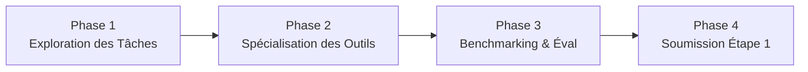

# Feuille de Route d'Action Immédiate – Google Agent Harness (PLE)

Ce document formalise la feuille de route opérationnelle pour développer, tester et soumettre le harnais d'agent pour la compétition **Google - Agent Harness on Physical-Engineering's Last Exam (PLE)** sur Kaggle.

---

---

## Phase 1 : Exploration des Tâches (Dev Set)

- [x] **Mise en place de l'environnement d'exploration** :
  - Création du notebook d'EDA [`kaggle_eda.ipynb`](file:///Users/mpaga/kaggle-projects/google_agent_harness/kaggle_eda.ipynb) avec installation `uv`.
  - Intégration des fonctions de scan récursif de fichiers et calcul de taille globale.
- [x] **Analyse et validation du Dev Set** :
  - Génération d'un dossier de tâche représentatif [`data/dev_task_demo/`](file:///Users/mpaga/kaggle-projects/google_agent_harness/data/dev_task_demo/) avec classeur Excel multi-onglets, cahier des charges PDF et relevés capteurs CSV.
  - Cartographie et classification opérationnelle validées :
    - Plans et spécifications techniques (`cahier_des_charges_structure.pdf`).
    - Feuilles de calcul et hypothèses de charges (`catalogue_profils_aciers.xlsx`).
    - Données tabulaires d'essais (`releve_charges_essais.csv`).
  - Validation du traitement bout-en-bout via le harnais d'agent avec génération automatique de livrable conforme.

---

## Phase 2 : Spécialisation des Outils (`src/tools.py`)

- [x] **Parseur PDF ciblé (*Targeted Retrieval*)** :
  - Implémentation de `inspect_pdf_file` (métadonnées, volume de pages, TOC).
  - Implémentation de `read_pdf_pages` (lecture par plages pour éviter la saturation de tokens).
  - Implémentation de `search_pdf_text` (recherche de mots-clés physiques et contextes).
- [x] **Outil d'inspection et extraction de tableurs** :
  - Implémentation de `inspect_excel_file` (détection des onglets et entêtes de colonnes via `openpyxl`/`pandas`).
  - Implémentation de `read_excel_sheet` (conversion tabulaire en Markdown paginé).
- [x] **Environnement d'exécution Python pour calculs d'ingénierie** :
  - Implémentation de `execute_python_code` (solveur déterministe sous-processus isolé).
  - Validation par tests unitaires (`tests/test_tools.py` validé à 100 %).
- [x] **Intégration et boucle ReAct dans le harnais** :
  - Mise à jour du catalogue d'outils et du protocole 4 phases dans [`src/prompt.py`](file:///Users/mpaga/kaggle-projects/google_agent_harness/src/prompt.py).
  - Routage dynamique `dispatch_tool` et boucle d'audit déterministe (*code-gated audit loop*) dans [`harness.py`](file:///Users/mpaga/kaggle-projects/google_agent_harness/harness.py).
  - 7 tests unitaires réussis sous `uv run pytest`.

---

## Phase 3 : Benchmarking & Évaluation Locale (`eval/run.py`)

- [ ] **Exécution sur les tâches d'exemple (`artifacts/`)** :
  - Configurer `eval/run.py` pour itérer sur les scénarios du dev set.
  - Exécuter le harnais sur les cas d'usage multi-disciplinaires (Structure, Fluides, Électrique).
- [ ] **Suivi des trois métriques clés** :
  1. **Taux de réussite des livrables** : proportion de rapports techniques conformes générés et validés par l'audit.
  2. **Temps d'exécution moyen** : durée de traitement par tâche (doit rester largement sous la limite de 6h).
  3. **Consommation de tokens** : mesure de l'efficacité du filtrage de contexte (*token economy*).
- [ ] **Consignation des traces d'évaluation** :
  - Sauvegarder les fichiers JSON de sortie dans `artifacts/` pour satisfaire les critères de soumission.

---

## Phase 4 : Préparation de la Soumission Étape 1

- [ ] **Rédaction du Kaggle Writeup (2 000 mots maximum)** :
  - Rédiger la synthèse technique dans [`writeup_submission.md`](file:///Users/mpaga/kaggle-projects/google_agent_harness/writeup_submission.md).
  - Description détaillée de l'architecture du harnais, des choix d'outils et de la stratégie de ciblage contextuel.
- [ ] **Production des 3 graphiques obligatoires** :
  1. **Diagramme d'architecture du harnais** : modélisé dans [`architecture_agent.mmd`](file:///Users/mpaga/kaggle-projects/google_agent_harness/architecture_agent.mmd).
  2. **Courbe score / coût en tokens** : comparaison entre ReAct naïf vs *Targeted Retrieval*.
  3. **Analyse des causes d'échec sur le dev set** : matrice d'erreurs par discipline technique.
- [ ] **Vérification finale du package de soumission** :
  - Vérifier la présence à la racine de `submission.yaml`, `serve.py`, `harness.py`, `LICENSE` et `artifacts/`.
  - Exécuter la commande de validation officielle de Kaggle.
